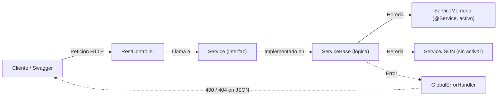

# 📚 Biblioteca Decroly · API REST

API REST hecha con **Spring Boot** para gestionar los **libros** y las **categorías** de una biblioteca.
Los datos viven **en memoria** (o se pueden cargar desde un **fichero JSON**) y la API está documentada con **Swagger (OpenAPI)**.

---

## 🧭 Flujo de la aplicación



1. **El cliente** hace una petición HTTP (GET, POST, PUT, DELETE).
2. **El `RestController`** recibe la petición y llama al método del servicio que toca.
3. **El `Service` (interfaz)** declara qué métodos existen: listar, buscar, crear, modificar y eliminar.
4. **El `ServiceBase`** desarrolla esos métodos. Ahí está toda la lógica: trabaja sobre una lista y valida los datos.
5. **El `ServiceMemoria` y el `ServiceJSON`** heredan del `ServiceBase` y solo se encargan de **rellenar esa lista**:
   - `ServiceMemoria`: crea los libros y las categorías directamente en el código. **Es el que se usa**, porque lleva `@Service` y Spring lo inyecta en los controllers.
   - `ServiceJSON`: lee `libros.json` / `categorias.json` desde `resources`. Ahora mismo **no está activo**: no lleva `@Service` y los `.json` no existen todavía.
6. **Si algo falla**, el servicio lanza una excepción (`NotFoundException` o `BadRequestException`) y el **`GlobalErrorHandler`** la convierte en una respuesta JSON con su código HTTP.

> El controller no sabe de dónde vienen los datos: solo habla con la interfaz `Service`. Así se puede cambiar de memoria a JSON sin tocar los controllers.

---

## 🗂️ Estructura del proyecto

```
biblioteca-decroly/
├── pom.xml
└── src/
    ├── main/
    │   ├── java/es/decroly/biblioteca/
    │   │   ├── BibliotecaDecrolyApplication.java  → Arranque de la app
    │   │   ├── config/       → Propiedades y configuración de Swagger
    │   │   ├── controllers/  → Endpoints REST
    │   │   ├── domain/       → Entidades (Libro, Categoria)
    │   │   ├── dto/          → Datos que llegan en el body
    │   │   ├── exceptions/   → Excepciones y manejador global de errores
    │   │   └── services/     → Lógica de negocio
    │   └── resources/
    │       └── application.properties
    └── test/
        └── java/es/decroly/biblioteca/  → Tests de los servicios
```

Cada carpeta tiene su propio `README.md` con el detalle de sus clases.

---

## 🧩 Clases principales

| Clase | Función |
|---|---|
| `BibliotecaDecrolyApplication` | Clase `main` que arranca Spring Boot |
| `BibliotecaProperties` | Lee las propiedades `biblioteca.*` de `application.properties` |
| `OpenApiConfig` | Título, versión y descripción de la documentación Swagger |
| `LibroRestController` / `CategoriaRestController` | Exponen los endpoints REST |
| `Libro` / `Categoria` | Entidades del dominio |
| `LibroPeticionDto` / `CategoriaPeticionDto` | Datos que llegan en el body al crear o modificar |
| `LibroService` / `CategoriaService` | Interfaces con los métodos del servicio |
| `LibroServiceBase` / `CategoriaServiceBase` | Desarrollan los métodos y validan los datos |
| `LibroServiceMemoria` / `CategoriaServiceMemoria` | Cargan 40 libros y 40 categorías de prueba en memoria |
| `LibroServiceJSON` / `CategoriaServiceJSON` | Cargan los datos desde `libros.json` / `categorias.json` |
| `NotFoundException` | Se lanza cuando no existe el recurso → **404** |
| `BadRequestException` | Se lanza cuando los datos no son válidos → **400** |
| `GlobalErrorHandler` | Captura las excepciones y devuelve el error en JSON |

---

## 🔌 Endpoints

### 📖 Libros (`/api/libros`)

| Método | Ruta | Descripción |
|---|---|---|
| `GET` | `/api/libros` | Lista todos los libros |
| `GET` | `/api/libros/disponibles` | Lista los libros con ejemplares disponibles |
| `GET` | `/api/libros/autor/{autor}` | Lista los libros de un autor (sin distinguir mayúsculas) |
| `GET` | `/api/libros/{id}/libros` | Lista los libros de una categoría (`id` = id de la **categoría**) |
| `GET` | `/api/libros/{id}` | Obtiene un libro por id |
| `POST` | `/api/libros` | Crea un libro |
| `PUT` | `/api/libros/{id}` | Modifica un libro por id |
| `DELETE` | `/api/libros/{id}` | Elimina un libro por id |

### 🏷️ Categorías (`/api/categorias`)

| Método | Ruta | Descripción |
|---|---|---|
| `GET` | `/api/categorias` | Lista todas las categorías |
| `GET` | `/api/categorias/{id}` | Obtiene una categoría por id |
| `POST` | `/api/categorias` | Crea una categoría |
| `PUT` | `/api/categorias/{id}` | Modifica una categoría por id |
| `DELETE` | `/api/categorias/{id}` | Elimina una categoría por id |

### 📨 Ejemplos de body

```json
// POST /api/libros
{
  "isbn": "9788491050292",
  "titulo": "Don Quijote de la Mancha",
  "autor": "Miguel de Cervantes",
  "anioPublicacion": "1605",
  "ejemplares": 2,
  "categoriaId": 16
}
```

```json
// POST /api/categorias
{
  "nombre": "Teatro",
  "descripcion": "Categoría de obras de teatro"
}
```

### ⚠️ Respuestas de error

| Código | Cuándo |
|---|---|
| `400 Bad Request` | Faltan datos obligatorios (ISBN, título, autor, nombre…) o `ejemplares < 1` |
| `404 Not Found` | No existe el libro o la categoría con ese id |

Los errores salen en formato `ProblemDetail`:

```json
{
  "type": "about:blank",
  "title": "Recurso no encontrado",
  "status": 404,
  "detail": "No se encontró el libro con id: 99",
  "instance": "/api/libros/99"
}
```

---

## ⚙️ Configuración

`src/main/resources/application.properties`:

```properties
biblioteca.nombre=Biblioteca Decroly
biblioteca.max-prestamos=3
biblioteca.dias-prestamo=15
server.port=8080
```

Spring carga las propiedades `biblioteca.*` en el record `BibliotecaProperties` (gracias a `@ConfigurationPropertiesScan`).

---

## 🏷️ Anotaciones usadas

```java
// ---- Spring Web ----
// @RestController      -> Clase que devuelve JSON
// @RequestMapping      -> Ruta base del controller
// @GetMapping          -> LEER datos
// @PostMapping         -> CREAR recurso
// @PutMapping          -> MODIFICAR recurso
// @DeleteMapping       -> BORRAR recurso
// @PathVariable        -> Valor de la ruta  -> /libros/{id}
// @RequestBody         -> JSON del body a objeto Java

// ---- Spring ----
// @Service             -> Spring crea el servicio y lo inyecta en los controllers
// @Configuration       -> Clase de configuración
// @ConfigurationProperties -> Lee propiedades con un prefijo
// @RestControllerAdvice    -> Manejador global de errores
// @ExceptionHandler        -> Qué hacer con cada excepción

// ---- Swagger ----
// @Tag / @Operation / @ApiResponse / @OpenAPIDefinition -> Documentación

// ---- Lombok ----
// @Getter / @Setter / @NoArgsConstructor / @AllArgsConstructor -> Genera código repetitivo
```

---

## ▶️ Cómo ejecutarlo

```bash
git clone https://github.com/JoaquinDecroly/<nombre-del-repo>.git
cd <nombre-del-repo>/biblioteca-decroly
./mvnw spring-boot:run
```

En Windows: `mvnw.cmd spring-boot:run`

Una vez arrancada la aplicación, la documentación interactiva de Swagger está en:

```
http://localhost:8080/swagger-ui.html
```

### 🧪 Tests

```bash
./mvnw test
```

---

## 🛠️ Tecnologías

- **Java 25**
- **Spring Boot 4.1.1** (Spring Web MVC)
- **SpringDoc OpenAPI 3.1.0** (Swagger UI)
- **Jackson 3** (lectura de JSON)
- **Lombok**
- **JUnit 5**
- **Maven**

---

👤 **Autor:** Joaquín Valentín Ottonello · [@JoaquinDecroly](https://github.com/JoaquinDecroly)
