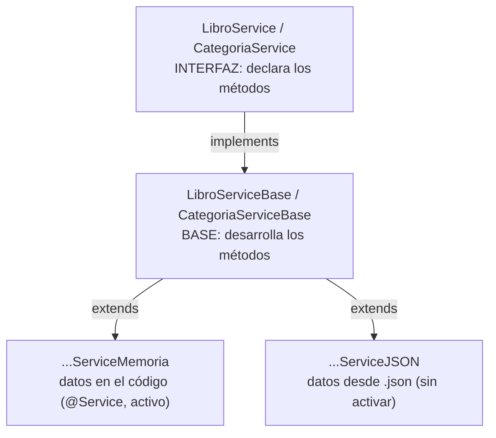

# 🧠 services

Lógica de negocio. Está dividida en **3 niveles** para separar *qué se hace* de *dónde salen los datos*.



## 1️⃣ Interfaz: `LibroService` / `CategoriaService`

Solo **declara** los métodos. Es lo único que conocen los controllers.

| LibroService | CategoriaService |
|---|---|
| `listarLibros()` | `listarCategorias()` |
| `buscarPorId(id)` | `buscarPorId(id)` |
| `listarLibrosDisponibles()` | — |
| `obtenerLibrosDeCategoria(id)` | — |
| `listarLibrosDeAutor(autor)` | — |
| `crear(dto)` | `crear(dto)` |
| `modificar(id, dto)` | `modificar(id, dto)` |
| `eliminar(id)` | `eliminar(id)` |

## 2️⃣ Base: `LibroServiceBase` / `CategoriaServiceBase`

**Desarrolla** todos los métodos sobre una `List` interna.

- **Constructor:** recibe la lista inicial, la copia en un `ArrayList` y arranca el contador de ids (`AtomicLong`) en el id más alto que haya.
- **`crear`:** valida, genera el siguiente id con `secuencia.incrementAndGet()` y añade el objeto.
- **`buscarPorId`:** busca con `stream().filter()`; si no existe → `NotFoundException` (404).
- **`modificar`:** valida, busca y cambia los campos con los setters.
- **`eliminar`:** `removeIf`; si no borra nada → `NotFoundException` (404).
- **`validar` (privado):** comprueba los campos obligatorios; si falla → `BadRequestException` (400).

## 3️⃣ Carga de datos

Solo se encargan de **pasarle la lista inicial al padre** con `super(...)`.

| Clase | De dónde salen los datos | ¿Activa? |
|---|---|---|
| `LibroServiceMemoria` | 40 libros creados en el constructor | ✅ `@Service` |
| `CategoriaServiceMemoria` | 40 categorías creadas en el constructor | ✅ `@Service` |
| `LibroServiceJSON` | `src/main/resources/libros.json` | ❌ |
| `CategoriaServiceJSON` | `src/main/resources/categorias.json` | ❌ |

### Cómo carga el JSON

```java
// ClassPathResource("libros.json") -> busca el fichero en resources
// try-with-resources               -> abre el fichero y lo cierra solo
// mapper.readValue(..., Libro[].class) -> convierte el JSON en un array
// List.of(...)                     -> pasa el array a lista
```

### Cómo cambiar a JSON

1. Crear `libros.json` y `categorias.json` en `src/main/resources`.
2. Quitar `@Service` de las clases `...Memoria` y ponérselo a las `...JSON`.
3. En `cargar(...)`, devolver `new ArrayList<>(List.of(...))`, porque el cast `(ArrayList<...>)` sobre `List.of(...)` lanza `ClassCastException`.

📄 Documentación completa en el [README principal](../../../../../../../README.md)
